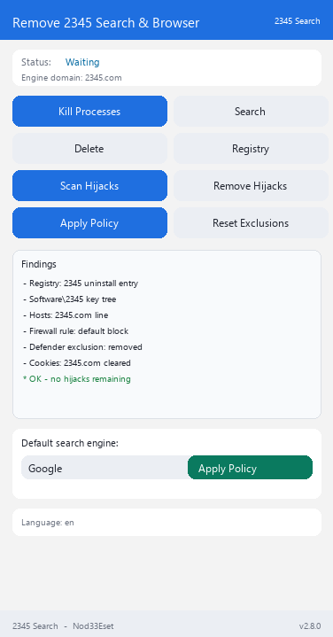

# Anti2345 Vanced

## 🌐 Languages

Interface available in 10 languages:

> 🇬🇧 English | 🇷🇺 Русский | 🇺🇦 Українська | 🇰🇿 Қазақша | 🇩🇪 Deutsch | 🇫🇷 Français | 🇪🇸 Español | 🇵🇱 Polski | 🇹🇷 Türkçe | 🇨🇳 中文

The active language is auto-detected from the system locale; switch it with the dropdown in the top-right corner of the app (or this file's sibling `translations.py`).


[](https://github.com/retvil/Anti2345Vanced/releases) [](https://github.com/retvil/Anti2345Vanced/releases) [](https://www.python.org/)

**Повне видалення 2345 Browser та жорсткий захист пошуку за замовчуванням від захоплення — 28 векторів (VANCED) / 39 векторів (EXTENDED), 10 пошуковиків, 10 мов інтерфейсу.**

[🇬🇧 English](README.md) | [🇷🇺 Русский](README.ru.md) | **🇺🇦 Українська** | [🇰🇿 Қазақша](README.kk.md) | [🇩🇪 Deutsch](README.de.md) | [🇫🇷 Français](README.fr.md) | [🇪🇸 Español](README.es.md) | [🇵🇱 Polski](README.pl.md) | [🇹🇷 Türkçe](README.tr.md) | [🇨🇳 中文](README.zh.md)

## Що це?

2345 встановлює не просто браузер — він тихо прописується пошуком і браузером за замовчуванням через багато механізмів системи: асоціації в реєстрі, enterprise-політики, налаштування профілів браузерів, навіть бази пошуковиків усередині профілів Chromium. Видалення одного браузера цього не скасовує.

**Anti2345 Vanced** (форк [TheCawa/AntiYandex](https://github.com/TheCawa/AntiYandex)) знаходить **усі вектори захоплення** (28 у VANCED, 39 у EXTENDED), прибирає їх однією кнопкою, а потім **жорстко закріплює пошук за замовчуванням** за обраним пошуковиком через enterprise-політики Windows — щоб ніщо не могло тихо повернути все назад.

## Можливості

- **Сканер захоплення** — детект 28 векторів (VANCED) / 39 векторів (EXTENDED): шляхи встановлення, записи Uninstall у реєстрі, асоціація `UserChoice`, реєстрації `StartMenuInternet`, дерева ключів `Software\2345`, hijack через політики `DefaultSearchProvider*`, `Preferences` профілів Chromium, ключові слова в `Web Data` (SQLite), `search.json.mozlz4` Firefox, legacy `SearchScopes`, автозапуск, планувальник задач, служби Windows, IME Switcher, файлові асоціації, інтеграція 2345 Disk у провіднику, вимкнений автозапуск, App Paths, ярлики, залишки в ProgramData/Roaming, записи в hosts, правила брандмауера, URI-протоколи, розширення браузерів, куки ant2345.ru, асоціації «відкрити за допомогою», сліди Prefetch/WER, винятки Defender, розкладки клавіатури, hijack стартової сторінки IE, політики стартових URL (`RestoreOnStartupURLs`), домашня сторінка Firefox, зона IE (zone map), записи RegisteredApplications, сліди MUICache, інсталятори в %TEMP%, Store-застосунки (2345 Music), каталоги продуктів, каталоги локальних даних, 2345.DNS
- **Видалення в один клік** — у кожного вектора свій remover; заблоковані бази чесно репортяться, без крашів
- **Жорстка політика пошуку** — закріплює пошук за одним із 10 пошуковиків (Google, Bing, DuckDuckGo, Brave Search, Startpage, Mojeek, Qwant, Ecosia, Yahoo, SearXNG) через HKLM-політики для Chrome, Edge, Brave, Vivaldi, Opera та 2345 Browser + `policies.json` для Firefox/Waterfox
- **Чистка политик** — вичищає значення `DefaultSearchProvider*` 2345 з реєстру
- **10 мов інтерфейсу** — ru, en, uk, kk, de, fr, es, pl, tr, zh; мова системи визначається автоматично
- **Легкий інтерфейс** — ttkbootstrap, вертикальна компоновка, зафіксовані статус-бар і футер

## Скріншот

<details>
<summary>Головне вікно</summary>



</details>

## Готові збірки

Завантажте з [Releases](https://github.com/retvil/Anti2345Vanced/releases):

- **Windows** — `Anti2345Vanced.exe` (портативний, один файл, ~35 МБ) — видалення 2345 Browser та 2345 Search
- **Windows** — `Anti2345Extended.exe` (портативний, один файл, ~35 МБ) — видалення всіх продуктів 2345 (2345 Disk, історія IME Switcher, загальносистемні сліди, Store-застосунки, 2345.DNS)

Запускайте **від імені адміністратора** — HKLM-політики та чистка реєстру потребують підвищених прав.

## Встановлення з джерел

Потрібен Python 3.10+ ([python.org](https://python.org)).

```bash
git clone https://github.com/retvil/Anti2345Vanced.git
cd Anti2345Vanced
pip install psutil ttkbootstrap
python main.py
```

Збірка свого EXE: запустіть `build.bat` (PyInstaller, результат у `dist/`).

## Використання

1. **Завершити процеси** → **Пошук 2345** → **Видалити 2345** — прибираємо сам браузер.
2. **Сканувати захоплення пошуку** — покаже всі способи, якими 2345 вріс у систему.
3. **Видалити захоплення** — спершу закрийте всі браузери, потім приберіть усе знайдене.
4. Виберіть пошуковик → **Застосувати політику** — пошук за замовчуванням закріплений на рівні системи.

## FAQ

- **Навіщо адміністратор?** Політики пошуку живуть в HKLM, чистка захоплення торкається системного реєстру — потрібні підвищені права.
- **«Database locked» у результатах?** Під час чистки був запущений Chromium-браузер. Закрийте всі браузери та повторіть видалення.
- **Як зняти політику пошуку?** Кнопка **Зняти політику 2345** вичищає значення политик; у Firefox можна також видалити файл `distribution\policies.json`.

## Автор і підтримка

**Nod33Eset** — форк [TheCawa/AntiYandex](https://github.com/TheCawa/AntiYandex). Issues та PR — вітаються.

Якщо інструмент позбавив вас від 2345а — можна підтримати розробку:

**Крипта:**

- BTC: `bc1qunld3rsp37qf5gg69aune50y0qqkd0eugg7j97`
- TON: `UQDmvr4SKOxSION3Yky6aOgzAnCDXySPuAbG4EKJa5JUT7tC`
- USDT (TRC20): `TBPJSSLu1mUcX54g9UyxUohYGf2fuRvbwd`
- USDT (ERC20): `0x25CAED3776Ef5b18E03392bC5b254Bbd78E8180C`
- USDT (SOL): `3qgN5z291CEcj2FUi2Zza5DioxKgNw72kC7P52pCcTrG`

## Ліцензія

MIT — див. [LICENSE](LICENSE).


